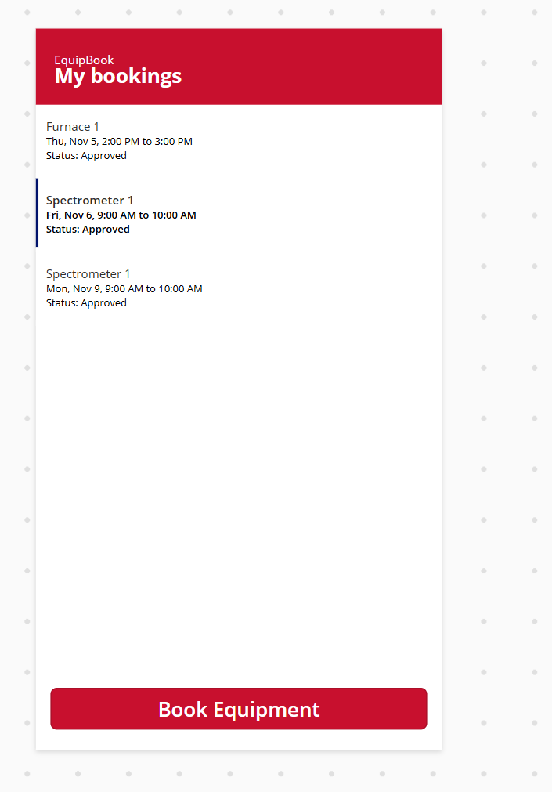
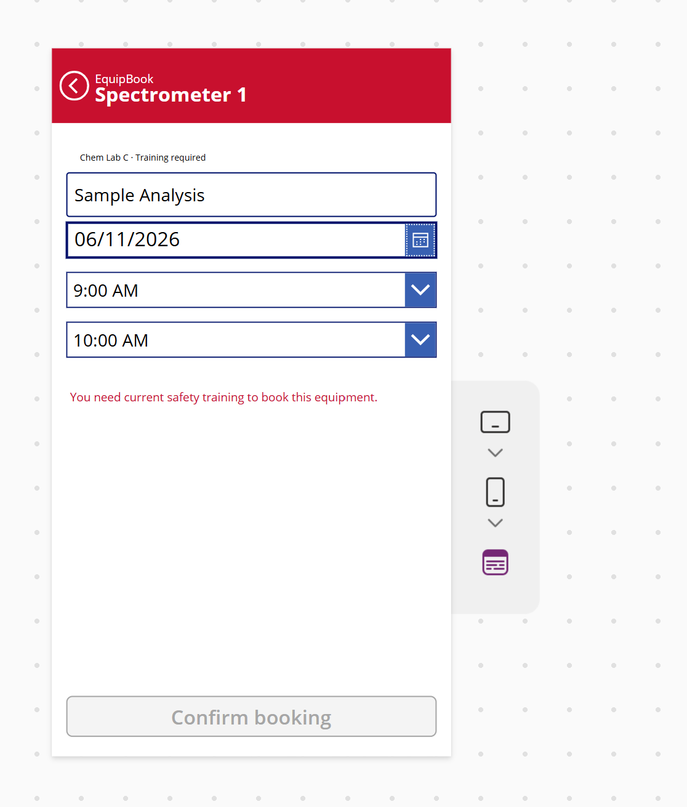
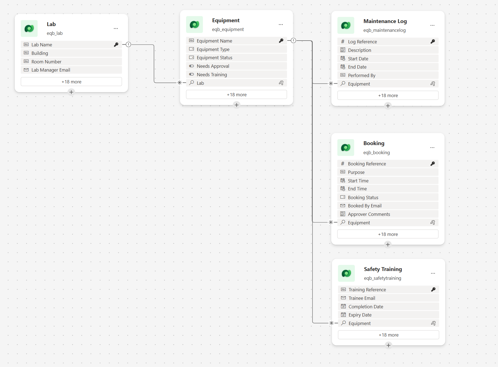
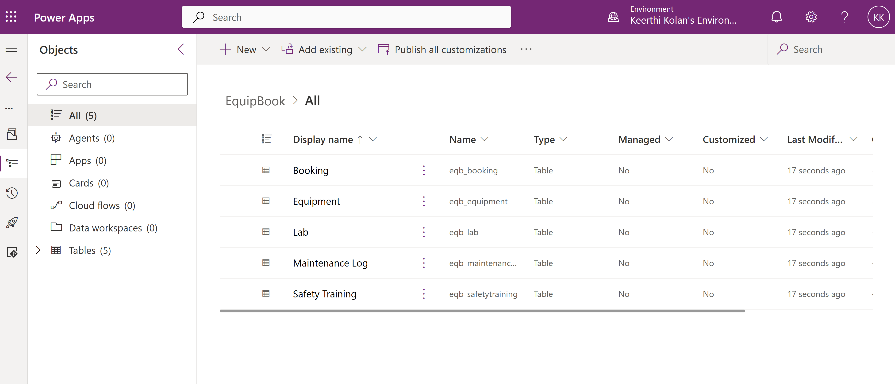
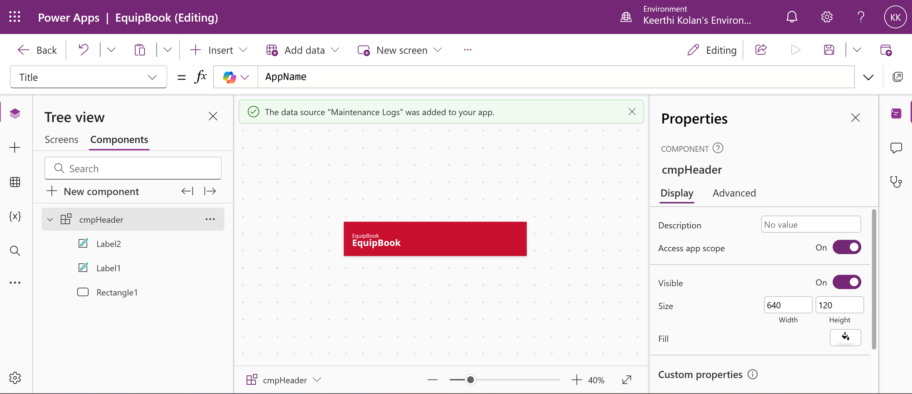
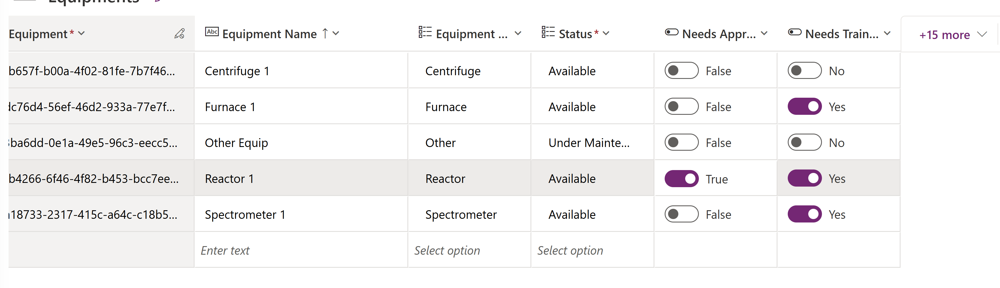

# EquipBook

EquipBook is an equipment booking app built with **Power Apps**, **Dataverse** and **Power Automate**. It's designed around a scenario that fits a chemical engineering department: researchers booking shared lab equipment.

Before a booking is saved, the app enforces the rules it needs:

- no overlapping bookings on the same equipment
- current safety training for equipment that requires it
- no bookings on equipment under maintenance
- a maximum booking length of four hours

  
  &nbsp;&nbsp;
  

---

## Contents

1. [Tech stack](#tech-stack)
2. [Data model](#data-model)
3. [The app](#the-app)
4. [Validation rules](#validation-rules)
5. [Reusable header component](#reusable-header-component)
6. [Automation](#automation)
7. [Design decisions](#design-decisions)
8. [Testing](#testing)
9. [Importing the solution](#importing-the-solution)
10. [Roadmap](#roadmap)

---

## Tech stack

| Layer | Technology |
| --- | --- |
| Data | Microsoft Dataverse (5 custom tables) |
| App | Power Apps canvas app (phone layout), Power Fx |
| Automation | Power Automate cloud flow |
| Packaging | One unmanaged solution, publisher prefix `eqb` |

---

## Data model

Five related Dataverse tables. Every relationship is one-to-many: Equipment belongs to a Lab, and Bookings, Safety Training records and Maintenance Logs each belong to one piece of Equipment.

  

| Table | Purpose | Key columns |
| --- | --- | --- |
| **Lab** | Where equipment lives, and who manages it | Lab Name, Building, Room Number, Lab Manager Email |
| **Equipment** | Each bookable item and its rules | Equipment Name, Type, Equipment Status (Available, Under Maintenance, Retired), Needs Approval, Needs Training, Lab |
| **Booking** | One reservation for one piece of equipment | Purpose, Start Time, End Time, Booking Status (Pending, Approved, Rejected, Cancelled), Booked By Email, Approver Comments, Equipment |
| **Safety Training** | Which person is trained on which equipment, and until when | Trainee Email, Completion Date, Expiry Date, Equipment |
| **Maintenance Log** | When equipment is out of service | Description, Start Date, End Date, Performed By, Equipment |

**Safety Training** works as a bridge between people and equipment: one person can be trained on many pieces of equipment, and one piece of equipment has many trained people.

  

---

## The app

A phone-layout canvas app with three screens.

| Screen | What it does |
| --- | --- |
| **Home** | The signed-in user's upcoming bookings, sorted by date, with their status. Shows a friendly message when there are none. |
| **Browse** | All equipment that isn't retired, with its lab and whether it needs training or approval. |
| **Book** | Purpose, date and half-hour time slots, live validation, and a Confirm button that only turns on when every rule passes. |

**Each user sees only their own bookings.** The home screen filters bookings by the signed-in user's email, hides past and cancelled bookings, and sorts by start time. The filter is written so Dataverse does the filtering on the server, which keeps it working as the number of bookings grows.

**Shared values are defined once.** Colors, spacing, the app name, the time slots and the four-hour limit are named formulas at the app level, so changing a value means editing it in one place.

---

## Validation rules

The booking screen checks every rule live, as the user fills in the form, and shows the first rule that fails. The Confirm button stays disabled until all of them pass.

| Rule | How it's checked | Message |
| --- | --- | --- |
| Purpose required | The purpose box isn't empty | "Enter a purpose for the booking." |
| End after start | The end time is later than the start time | "End time must be after start time." |
| Maximum length | The booking is four hours or less | "Bookings can be at most 4 hours." |
| Future only | The start time hasn't passed | "Pick a time in the future." |
| Equipment available | The equipment's status is Available | "This equipment is not available right now." |
| No maintenance | No maintenance log overlaps the requested time | "This equipment has maintenance scheduled during that time." |
| Safety training | If the equipment needs training, the user has a training record for it that's valid on the booking date | "You need current safety training to book this equipment." |
| No overlap | No active booking for the same equipment overlaps the requested time | "That time overlaps an existing booking." |

**How overlaps are detected:** two time ranges clash when the existing one starts before the new one ends, and ends after the new one starts. The same check is used for maintenance windows. Cancelled and rejected bookings are ignored.

**Saving:** when the user confirms, the booking is saved to Dataverse. Equipment that needs approval is saved as **Pending**; everything else is **Approved**. If saving fails, the user sees a clear error message instead of a silent failure.

---

## Reusable header component

The red header is one canvas component, reused on every screen.

| Property | Type | Purpose |
| --- | --- | --- |
| **Title** | Input (text) | The screen title. Defaults to the app name. |
| **ShowBack** | Input (yes/no) | Shows or hides the back arrow. |
| **OnBack** | Event | Raised when the back arrow is tapped. |

The component **doesn't navigate by itself**. It raises the OnBack event, and each screen decides what "back" means. That keeps the component reusable anywhere.

  

---

## Automation

**Flow: EquipBook – Booking confirmation** (Power Automate, inside the solution)

1. **Trigger:** a new row is added to Bookings in Dataverse
2. **Look up the equipment:** loads the booked equipment, for its name
3. **Check the status:**
   - **Approved:** builds a "Booking confirmed" message
   - **Pending:** builds a "Request received, waiting for approval" message
4. **Readable times:** start and end times are converted from UTC to Central time, for example "Friday, Nov 6, 9:00 AM"

The flow runs only when a booking is **added**, so later status changes can't trigger it again in a loop.

---

## Design decisions

- **Dataverse over SharePoint:** real relationships between tables, security roles, and queries that scale.
- **Server-side filtering:** the home screen filter avoids functions that Dataverse can't process on the server, so it doesn't silently stop at the first few hundred rows.
- **Copilot, then review:** Copilot drafted the five tables. Reviewing them caught three problems, which I fixed:
  - a yes/no column with its labels swapped
  - two columns named **Status** that clashed with Dataverse's built-in Status column, renamed to **Booking Status** and **Equipment Status**
  - a duplicate manager email column on Equipment, removed because the lab already holds it
- **Values defined once:** theme, spacing and business limits live in one place instead of being repeated across screens.
- **Component events** instead of navigation inside the component.
- **Relative layout:** controls are positioned relative to each other, so moving one doesn't break the screen.
- **US date format** set explicitly, so dates don't depend on the viewer's browser region.

---

## Testing

The test data is set up so each rule can be checked:

| Equipment | Test data |
| --- | --- |
| Spectrometer 1, Centrifuge 1 | Available, no training or approval needed |
| Furnace 1 | Needs training; the test user's training is valid |
| Reactor 1 | Needs training and approval; the test user's training has expired |
| Other Equip | Under maintenance, with a maintenance log covering the current dates |

  

| # | Test | Expected | Result |
| --- | --- | --- | --- |
| 1 | Spectrometer 1, valid purpose and time | Saves, appears on My bookings | ✅ Pass |
| 2 | Spectrometer 1, overlapping an existing booking | "That time overlaps an existing booking." | ✅ Pass |
| 3 | Furnace 1, valid training | Saves | ✅ Pass |
| 4 | Reactor 1, expired training | "You need current safety training…" | ✅ Pass |
| 5 | Other Equip, under maintenance | "This equipment is not available right now." | ✅ Pass |
| 6 | Centrifuge 1, 5-hour booking | "Bookings can be at most 4 hours." | ✅ Pass |
| 7 | Centrifuge 1, end before start | "End time must be after start time." | ✅ Pass |
| 8 | Bookings made by another user | Not shown on My bookings | ✅ Pass |
| 9 | New booking saved | Flow runs and builds the right message | ✅ Pass |

---

## Importing the solution

The exported solution is in the [`solution`](solution) folder. It contains the tables, the app, the component and the flow. It doesn't contain data rows.

1. Go to [make.powerapps.com](https://make.powerapps.com) and choose an environment with Dataverse.
2. **Solutions → Import solution →** select the zip → **Next**.
3. When asked, create or select a **Dataverse** connection for the flow.
4. **Import**, then **Publish all customizations**.
5. Add a few rows of test data (labs, equipment, training records), then open the **EquipBook** app.

---

## Roadmap

- [ ] Approval workflow: equipment that needs approval sends a request to the lab's manager, and the decision updates the booking
- [ ] Booking details screen with cancel
- [ ] Model-driven admin app for lab managers
- [ ] Dataverse security roles: Researcher, Lab Manager, Admin
- [ ] Scheduled reminder the day before a booking
- [ ] Environment variables for the booking limit and admin email

---

Built by Keerthi Kolan.
